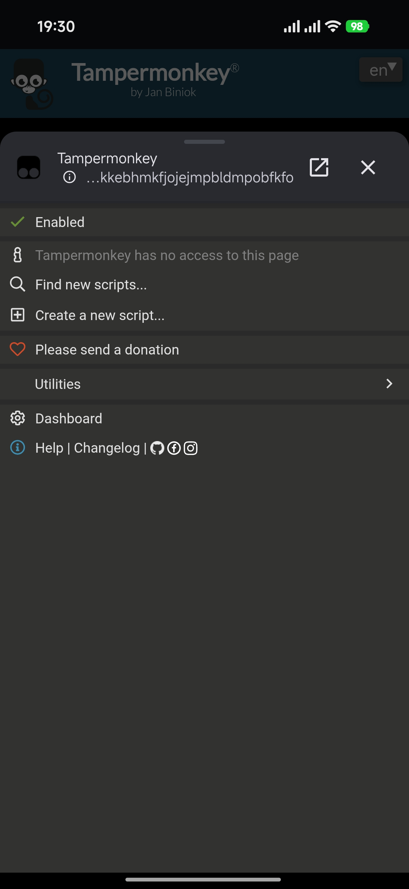
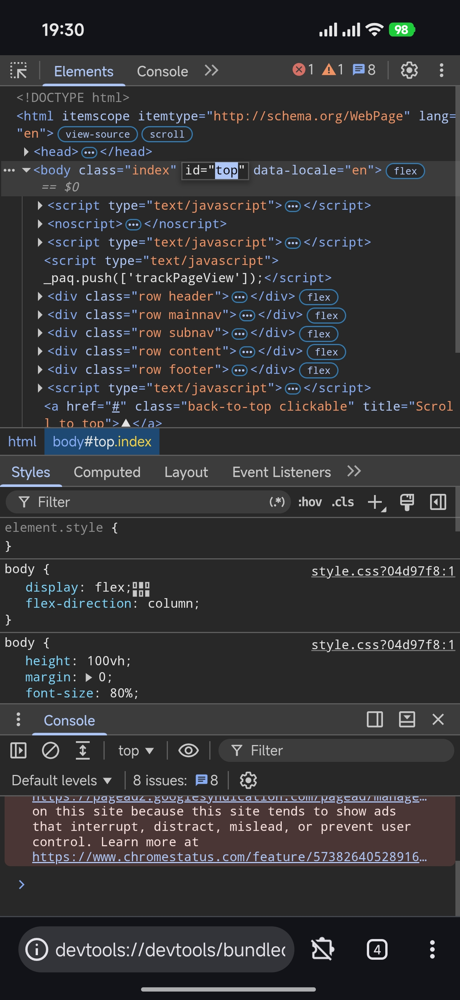
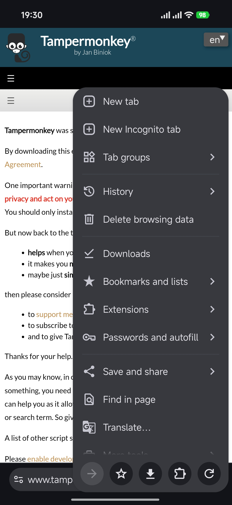

<h1 align="center">Alice Browser for Android</h1>

  

  English | <a href="https://github.com/iMortRex/android-alice-browser/blob/main/README_CN.md">中文</a>

   

A secure, fully open-source, Chromium-based android web browser with extension support, based on [Tianium Browser](https://github.com/jqssun/android-titanium-browser). Built with extensive AI assistance and tested/modified by me.

Thanks to [Tianium Browser](https://github.com/jqssun/android-titanium-browser) and all creators. If you want to build a similar browser or learn more about it, check out [Tianium Browser](https://github.com/jqssun/android-titanium-browser).

I built this browser for my own use for the time being, so I’m not accepting issues or pull requests. Sorry! :(

| Extensions | DevTools | Menu |
|---|---|---|
|  |  |  |

---

# What has changed?

- DevTools opens in a new tab instead of a new window.
- Extensions now open in a preview page instead of a bubble, and they can now also follow the browser's light/dark theme.
- Disabled "Match Chrome color scheme" by default in DevTools, so it follows the browser's light/dark theme.
- No longer avoids the screen cutout in fullscreen, allowing videos and fullscreen images to fill the screen.
- Adjusted the display duration of the undo bubble when closing a tab.
- Disabled the "How to exit" bubble prompt in fullscreen.
- Changed the default values of browser settings.
- Disabled swipe-up on the toolbar to open the tab management page.
- Tabs in the tab management page are aligned to the bottom.
- When the address bar is set to the bottom, search suggestions follow the search bar at the bottom instead of appearing above.
- Removed the home button from the toolbar.
- The translation bubble is now aligned to the bottom.
- A new tab now opens automatically when the last tab is closed, and closing the last tab does not exit the browser.
- Fixed an issue where repeatedly tapping the new tab button in quick succession created duplicate new tabs.
- Disabled hiding the toolbar when swiping up on a webpage.
- Disabled edge-swipe forward/back navigation.
- Added rounded corners to the search engine icon in the search bar.
- Added a setting that toggles whether a space is appended after the inserted text when tapping "Fix search query".
- Pinned the toolbar so it no longer follows left/right swiping (the current default version that follows the swipe has too many bugs).
- The top buttons in the menu are now pinned to the bottom.
- Adjusted menu button functions.
- Moved the top buttons on the tab management page to the bottom and adjusted their order.
- When the homepage is set to a custom URL, new tabs will also use that custom URL.
- Fixed many animation details.
- And more...
