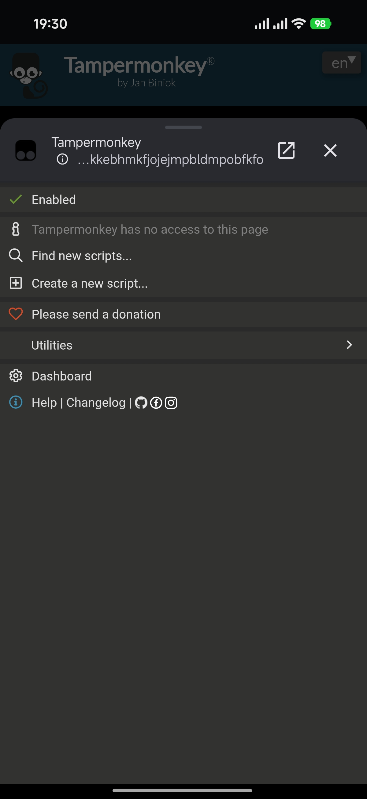
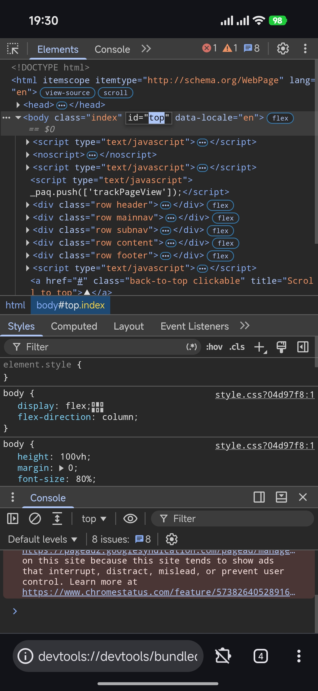
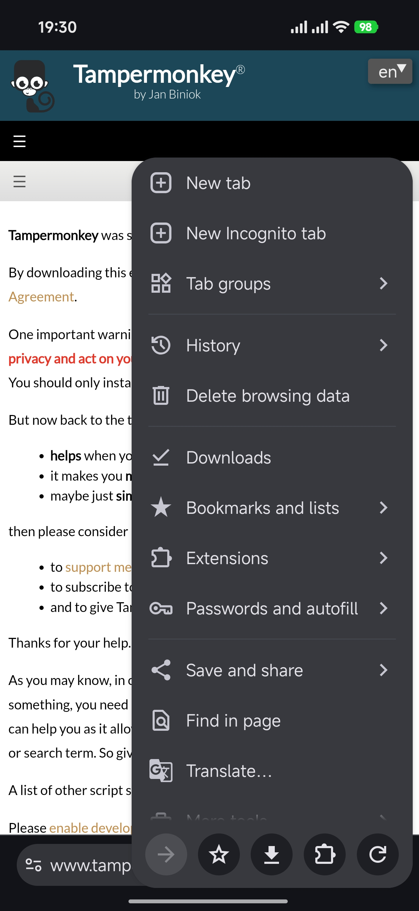

# Alice Browser for Android

[English](https://github.com/iMortRex/android-alice-browser/blob/main/README.md) | 中文

一个安全且完全开源、基于 Chromium 的网页浏览器，支持扩展，基于 [Tianium Browser](https://github.com/jqssun/android-titanium-browser)。借助大量 AI 帮助，并由我进行测试/修改。

感谢 [Tianium Browser](https://github.com/jqssun/android-titanium-browser) 及所有创作者。如果你想构建一个类似这样的浏览器，或想了解更多，可以查看 [Tianium Browser](https://github.com/jqssun/android-titanium-browser)。

这个浏览器暂时只为了我个人使用而创作，因此不接受 issue 和 pull request 请求。抱歉！:(

| 扩展 | 开发者工具 | 菜单 |
|---|---|---|
|  |  |  |

---

# 都修改了什么?

- Devtools在新标签页打开，而不是在新窗口中打开
- 扩展在预览网页中打开，而不是在新窗口中打开，并使其可以跟随浏览器深浅色
- Devtools默认关闭“与 Chrome 配色方案匹配”，使其可以跟随浏览器深浅色
- 全屏时不再避让屏幕挖孔，让观看视频和全屏查看图片时能占满屏幕
- 调整关闭标签页时撤销气泡的显示时间
- 禁用全屏时“如何退出”的气泡提示
- 改变浏览器设置的默认值
- 禁用上滑工具栏打开标签管理页
- 标签管理页标签居下
- 搜索框和搜索推荐在地址栏设置为底部时跟随搜索框居下而不是在上方
- 去除工具栏主页按钮
- 翻译气泡提示居下
- 关闭最后一个标签页时自动打开一个新标签页
- 修复短时间内重复点击新建标签页按钮时重复创建新建标签页
- 禁用上滑网页时隐藏工具栏
- 禁用边缘滑动前进/后退
- 搜索框搜索引擎图标圆角
- 设置中增加点击“修复搜索查询”时，填入的文本后面是否增加空格开关
- 固定工具栏，不跟随左右滑动（现在默认跟随的版本bug太多）
- 菜单顶部按钮固定到底部
- 菜单按钮功能调整
- 标签页管理页面顶部按钮移动到底部，并调整按钮顺序
- 设置主页为自定义网址时，新标签页会跟随变动，且关闭最后一个标签页后不会退出浏览器
- 以及更多新功能...
